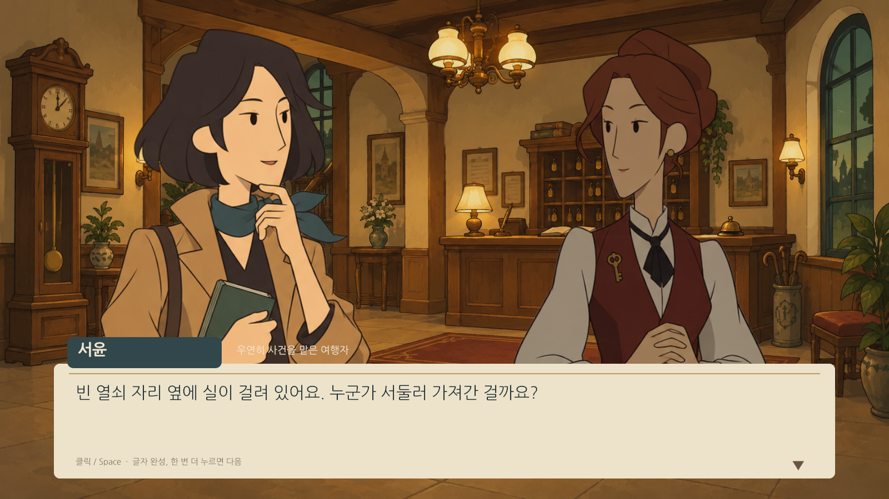
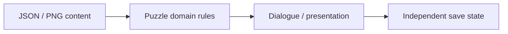

# Moonlit Hotel / 잔월 호텔

[English](README.md) · [Korean](README.ko.md) · [Japanese](README.ja.md)

**C# · Unity · JSON / PNG** · プレイ可能なプロトタイプ

[開発事例を見る](https://ysl-ryudo.github.io/ja/work/moonlit/) · [Portfolio](https://ysl-ryudo.github.io/ja/)

Puzzle Spireのブロックパズル規則を基盤とする、プレイ可能なUnity推理アドベンチャーのプロトタイプです。ゲーム内の物語・パズル制作機能を備えています。

## 取り組んだ課題

推理アドベンチャーの調査・会話・パズルを連携し、新しい物語の制作・読み込み時に本編と保存状態が混ざらないよう構成しました。

## 担当した実装と設計

パズルのドメインルールと表示を分離し、クリア検証、物語の編集・書き出し、ローカルMODごとの独立した保存状態を実装しました。

### 実装概要 · 概念フロー

## 担当した内容

- 調査・会話・パズルの進行を実装し、パズルのドメイン規則と画面表示を分離しました。
- パズルのクリア検証、物語編集・書き出し、MODごとのセーブ分離を実装しました。
- ローカルJSON・PNGの読み込みとテーマ切り替えを実装しました。別プラットフォームのバックエンドは本クライアントの担当範囲に含めません。

## 貢献の根拠

- [Documented source baseline](https://github.com/YSL-RyuDo/Puzzle-Spire/tree/70129f77f42290735ff768192b63a08558fb2d84)

コミットは記載した変更の根拠であり、貢献率の点数ではありません。外部素材・チームメンバーの貢献は区別します。

## 実行・コードの確認

[ProjectVersion.txt](ProjectSettings/ProjectVersion.txt)記載のUnity版で開いてください。パッケージロックとシリアライズ済み素材を維持し、Unityを開く前に対象ブランチを選んでください。

- Unity scene: [Assets/Game/Scenes/Hotel.unity](Assets/Game/Scenes/Hotel.unity)

## 開発・検証範囲

プレイ可能なプロトタイプです。既存READMEの2026-10-08記録にはEditMode 141件成功があり、その後の物語MODの通し検証もあります。合法手による自動進行・UI検査は人間の難易度・面白さ評価を代替しません。制作室からのプラットフォーム直接アップロードは未実装で、外部ZIPはMODフォルダーに展開します。

## 詳細資料

- [既存の詳細開発・利用・検証資料（韓国語）](docs/DEVELOPMENT_REFERENCE.ko.md)
- [Docs/FullPlayVerification.md](Docs/FullPlayVerification.md)
- [Docs/HotelPrototype.md](Docs/HotelPrototype.md)
- [Docs/ThemeMods.md](Docs/ThemeMods.md)

## 実装の確認方法

2026-10-08の記録にはEditModeテスト141件があります。全体プレイ・ストーリーMODの確認記録も参照できます。合法手の検証だけで人間の難易度や楽しさは証明できません。
