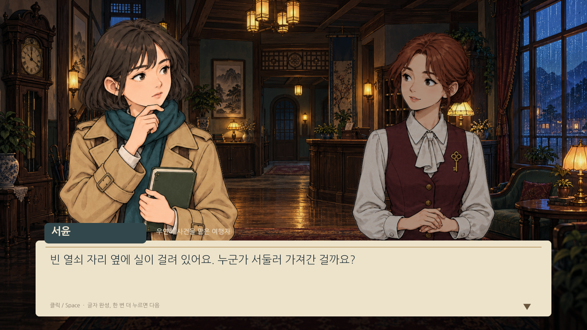
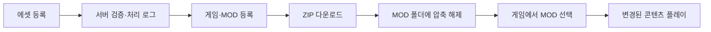
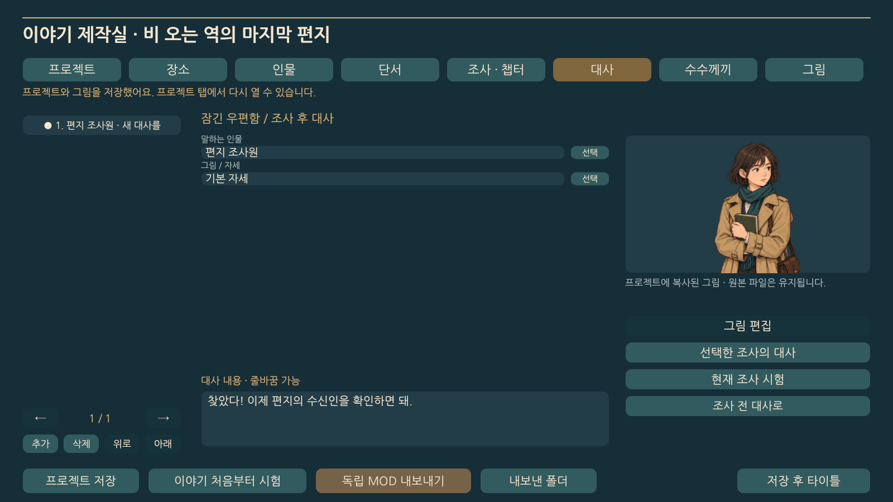
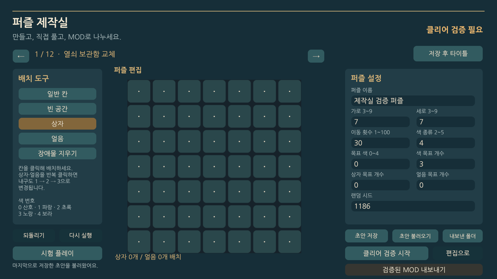
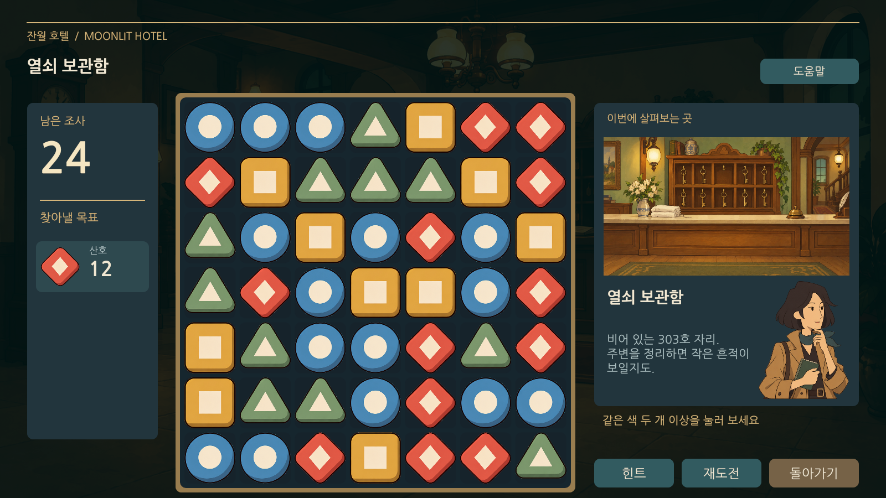

<div align="center">

# 잔월 호텔 · MOONLIT HOTEL

**호텔의 수수께끼를 풀고, 당신의 이야기를 MOD로 만드세요.**

2D 추리 어드벤처 × 블록 퍼즐 × 게임 내 콘텐츠 제작

`Unity 6000.3.1f1` · `Windows PC` · `C#` · `JSON + PNG MOD` · `Playable Prototype`

[시작하기](#시작하기) · [MOD로 바뀌는 것](#mod로-바뀌는-것) · [직접 만들기](#직접-만들기) · [개발 문서](#개발-문서)


*사라진 열쇠 하나. 빈 객실에서 울리는 전화. 오래된 호텔에 남겨진 약속.*

</div>

잔월 호텔은 **장소 조사와 인물 대화, 블록 퍼즐과 수수께끼를 연결한 PC 게임**입니다. 걷기 조작 없이 장소를 선택하고, 단서를 모으며 사건을 해결합니다. 하나의 넓은 배경 위에서 조사와 대화가 이어집니다.

이 저장소는 **Puzzle Spire 퍼즐 시스템을 기반으로 한 게임 클라이언트와 MOD 제작 도구**를 담고 있습니다. 플레이어는 그림을 바꾸는 테마를 적용하거나, 게임 안에서 새 이야기와 퍼즐을 만들어 독립 MOD로 내보낼 수 있습니다.

| 본편 조사 | 블록 퍼즐 | 수수께끼 | 등장인물 |
| :---: | :---: | :---: | :---: |
| **20개** | **12개** | **4개** | **주인공 + NPC 3명** |

## MOD로 바뀌는 것

**같은 장면도 다른 그림으로. 새 사건은 별도의 이야기로.**

| 기본 테마 | 클래식 일러스트 MOD |
| :---: | :---: |
|  |  |
| 기본 그림으로 진행 | 배경과 인물을 교체하고 같은 진행 이어가기 |

| 종류 | 바꿀 수 있는 내용 | 진행 데이터 |
| --- | --- | --- |
| **테마 MOD** | 인물·포즈, 장소 배경, 블록·장애물, 수집품 등 이미지 | 기본 이야기의 저장 공유 |
| **콘텐츠 MOD** | 기존 조사·대사·퍼즐·수수께끼 데이터 교체 또는 추가 | MOD별 저장 분리 |
| **독립 이야기 MOD** | 자체 장소·인물·조사·대사·퍼즐·수수께끼·엔딩 | 기본 이야기와 분리 실행 |

MOD는 **JSON 데이터와 PNG 이미지**를 사용합니다. 현재 한 번에 하나를 활성화하며, 외부 실행 코드를 불러오는 방식은 지원하지 않습니다. 그림 교체와 임의의 UI 레이아웃 편집은 서로 다른 기능이며, 후자는 게임 내 MOD 도구의 지원 범위에 포함되지 않습니다.

### 플랫폼에서 게임까지

플랫폼 시연은 **에셋 등록·검증 → 게임과 MOD 등록 → 다운로드 → 게임 내 적용**을 연결합니다. 이미지 업로드 처리, 중복 검사, 저장 결과와 다운로드 요청은 서버 로그로 확인합니다.



이 저장소의 담당 범위는 **게임 실행, 로컬 제작, MOD 내보내기·선택·적용**입니다. 플랫폼 서버 기능은 별도 서비스이며, 게임 내 제작실에서 플랫폼으로 직접 업로드하는 기능은 아직 제공하지 않습니다. 플랫폼 발표 영상의 편집 구성은 [편집 스크립트](Tools/edit_platform_flow_presentation.py)에 기록되어 있습니다.

## 직접 만들기

### 01 · 이야기 제작실

장소와 인물을 만들고, 조사 순서에 대사와 퍼즐을 연결합니다. 작성한 이야기를 처음부터 시험한 뒤 **독립 MOD ZIP**으로 내보낼 수 있습니다.



| 편집 대상 | 제작 기능 |
| --- | --- |
| 장소·인물·단서 | 이름과 설명 작성, PNG 가져오기와 이미지 영역 자르기 |
| 조사·챕터 | 장소, 선행 조사, 퍼즐 연결, 보상 단서 지정 |
| 대사 | 조사 전·후 대사, 줄 추가·삭제·순서 변경, 화자·포즈 선택 |
| 수수께끼 | 선택형·순서형 문제, 정답·힌트·해설 작성 |
| 이야기 | 현재 조사 시험, 처음부터 시험, 엔딩 설정, 독립 MOD 내보내기 |

**프로젝트 만들기 → 그림 넣기 → 조사와 대사 연결 → 퍼즐 검증 → 시험 플레이 → MOD 내보내기**

### 02 · 퍼즐 제작실

보드 모양, 상자와 얼음, 이동 횟수와 목표를 설정합니다. **제작자가 실제 규칙으로 클리어한 퍼즐만 검증된 MOD로 내보낼 수 있습니다.**

| 보드 편집 | 게임에서 플레이 |
| :---: | :---: |
|  |  |

일반 시험 플레이와 클리어 검증을 구분합니다. 보드·목표·횟수·시드를 바꾸면 기존 인증이 무효화되어 다시 검증해야 합니다. 인증은 풀 수 있다는 근거이며, 플레이어는 제작자와 다른 순서로 풀어도 됩니다. 위 화면은 각각 제작실과 본편 플레이 예시이며, 같은 퍼즐의 전후 비교는 아닙니다.

> **현재 제작 범위** — 2D 조사·대화·블록 퍼즐·수수께끼 규칙을 활용한 이야기 제작. PNG 편집은 가져오기·자르기·방향 설정을 지원합니다. 브러시로 직접 그리기, 임의의 새 게임 규칙, 선택지 기반 이야기 분기와 여러 엔딩은 후속 개발 범위입니다.

## 시작하기

### Unity에서 실행

1. 저장소를 내려받고 Unity Hub에서 프로젝트 폴더를 추가합니다.
2. **Unity 6000.3.1f1**로 열고 패키지와 에셋 가져오기가 끝날 때까지 기다립니다.
3. [`Assets/Game/Scenes/Hotel.unity`](Assets/Game/Scenes/Hotel.unity)를 열고 **Play**를 누릅니다.

Editor 메뉴의 `Puzzle Spire > 호텔 프로토타입 열기`로도 씬을 열 수 있습니다. `PuzzleTest.unity`는 기존 퍼즐 실험용 씬입니다.

### 플레이와 MOD 설치

| 할 일 | 방법 |
| --- | --- |
| 조사·퍼즐 조작 | 화면의 대상과 버튼을 마우스로 클릭 |
| 대사 진행 | 클릭 / Space / Enter — 첫 입력은 글자 완성, 다음 입력은 다음 대사 |
| 외부 MOD 설치 | 타이틀 → **MOD 관리 → MOD 폴더 열기** → ZIP 압축 해제 → **목록 새로고침 → MOD 선택** |
| 기본 테마로 복귀 | MOD 관리에서 **기본 이야기** 선택 |
| 새 콘텐츠 제작 | 타이틀의 **이야기 제작실** 또는 **퍼즐 제작실** |

MOD 폴더 안에는 각 MOD의 `manifest.json`이 있어야 합니다. ZIP 파일 자체를 넣는 자동 설치는 지원하지 않습니다.

```text
Mods/
└── MyMod/
    ├── manifest.json
    ├── content.json       # 콘텐츠를 포함하는 MOD
    └── Images/
        └── background.png
```

실제 사용자 데이터 경로는 게임 **설정**에서 확인할 수 있습니다. 조사 완료와 장소 이동 때 저장하며, 진행 중인 퍼즐은 재실행 시 해당 조사부터 다시 시작합니다.

## 개발자가 수정할 곳

**UI는 씬과 프리팹에 저장되어 있습니다.** Hierarchy와 Inspector에서 배치·크기·색상·이미지를 수정할 수 있으며, 게임 실행 시 UI 전체를 코드로 다시 만들지 않습니다.

```text
Assets/
├── Game/
│   ├── Domain/                  # 블록 퍼즐 규칙
│   ├── Hotel/
│   │   ├── Content/             # 콘텐츠·MOD 데이터 처리
│   │   ├── Gameplay/            # 호텔 게임 진행
│   │   ├── Presentation/        # 화면·대화·제작실 연결
│   │   ├── Prefabs/             # 편집 가능한 제작실 UI
│   │   └── Tests/               # 호텔 시스템 테스트
│   └── Scenes/Hotel.unity       # 메인 씬
└── StreamingAssets/Hotel/       # 기본 콘텐츠와 내장 테마
Docs/                           # 기능·편집·검증 문서
Tools/                          # 콘텐츠 작성·시연 영상 도구
```

씬의 `Hotel Canvas · EDIT UI HERE`와 [`StoryStudio.prefab`](Assets/Game/Hotel/Prefabs/StoryStudio.prefab)이 UI 편집 출발점입니다. 기본 대사·조사·퍼즐은 [`base.json`](Assets/StreamingAssets/Hotel/base.json)에서 확인할 수 있습니다.

<details>
<summary><strong>빌드와 검증 방법 펼치기</strong></summary>

Unity Test Runner의 **EditMode → Run All**로 테스트를 실행합니다. Windows 빌드는 다음 Editor 진입점을 사용합니다.

```powershell
& "<Unity.exe 경로>" -batchmode -nographics `
  -projectPath "<프로젝트 경로>" `
  -executeMethod PuzzleSpire.Hotel.Editor.HotelSceneBuilder.CreateAndBuild `
  -quit -logFile "<빌드 로그 경로>"
```

출력은 `Builds/Hotel/MoonlitHotel.exe`이며, 배포 시 실행 파일과 데이터 폴더를 함께 제공해야 합니다. 빌드·녹화 결과물은 Git 추적에서 제외됩니다.

| 실행 옵션 | 검사 대상 |
| --- | --- |
| `-hotel-smoke` | 본편 진행, 퍼즐, 저장, MOD 통합 검사 |
| `-hotel-theme-review` | 테마 전환과 기본 저장 유지 |
| `-hotel-workshop-review` | 퍼즐 편집·클리어 검증·내보내기 |
| `-hotel-studio-review` | 이야기 제작·시험·독립 MOD 내보내기 |

**기록된 검증:** 2026-10-08 EditMode 141/141 통과 및 본편 회귀 검사 통과. 2026-10-12 이야기 제작 시연은 실제 UI 입력과 합법적인 퍼즐 플레이로 독립 MOD 선택부터 엔딩·저장 복원까지 확인했습니다. 이는 해당 시점의 로컬 검증 결과이며 CI 상태를 나타내지 않습니다.

영상 편집 스크립트에는 로컬 원본 영상과 인코더 경로가 포함되어 있습니다. 다른 PC에서 재사용할 때 해당 경로와 입력 파일을 준비해야 합니다.

</details>

## 개발 문서

| 문서 | 내용 |
| --- | --- |
| [MOD와 제작실](Docs/ThemeMods.md) | 이미지 키, MOD 형식, 퍼즐·이야기 제작, 저장 정책 |
| [프로토타입 실행 안내](Docs/HotelPrototype.md) | 본편 구성, 콘텐츠 데이터, 빌드·실행 |
| [PC 화면과 UI 편집](Docs/PCStagePresentation.md) | 단일 화면 연출과 Hierarchy 구조 |
| [조사 연출](Docs/VisualInvestigation.md) | 물건 확대, 인물 포즈, 퍼즐 연출 |
| [수집품 보관함](Docs/CollectionCabinet.md) | 그림 카드와 상세 기록 편집 |
| [전체 플레이 검증](Docs/FullPlayVerification.md) | 자동 플레이와 검증 기록 |

일부 문서는 초기 구현의 기록을 포함합니다. MOD·제작실의 후속 변경 사항은 **MOD와 제작실** 문서를 함께 확인해 주세요. 스크린샷은 실제 실행 화면이며, 현재 기본·클래식 테마에는 AI 생성 이미지 에셋이 사용됩니다.
